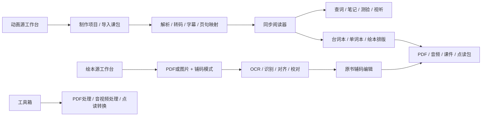
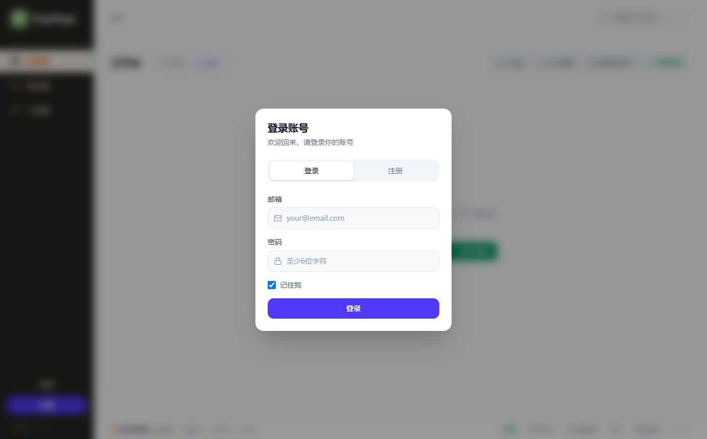
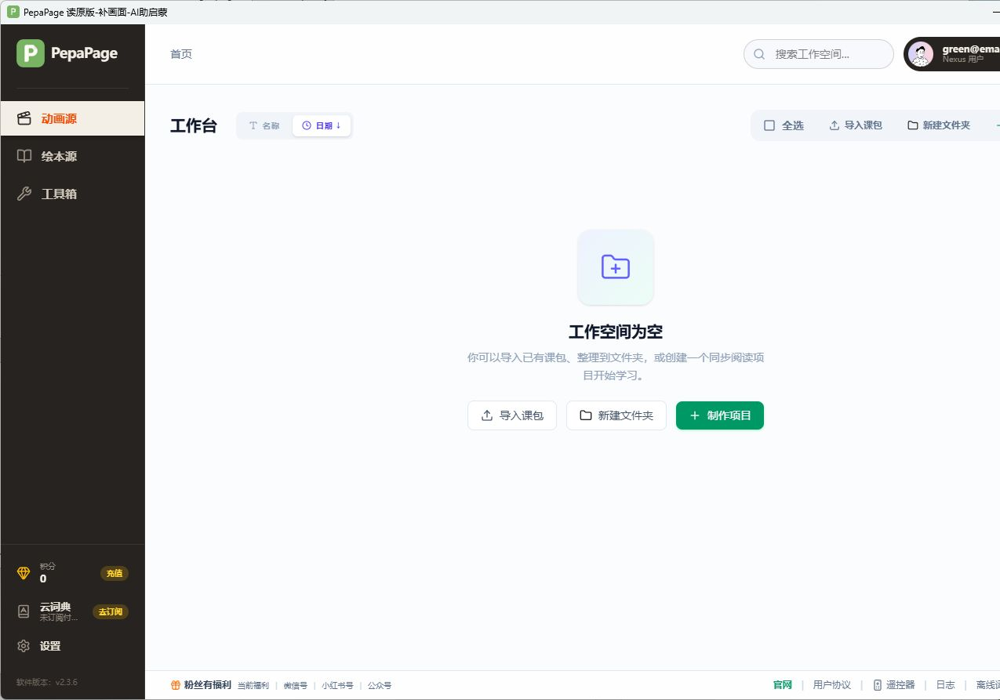
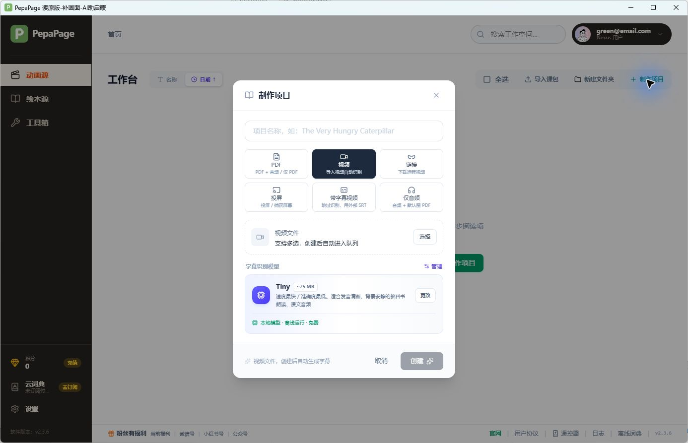
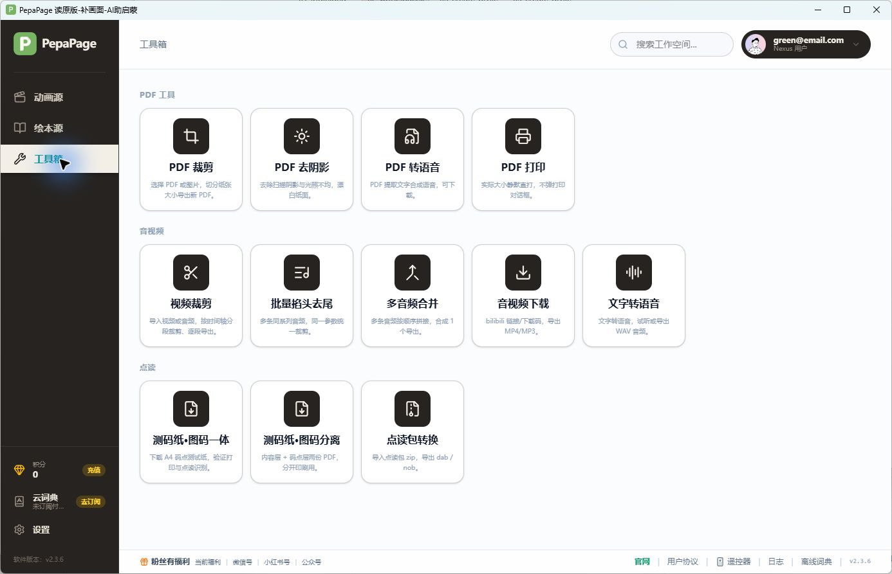
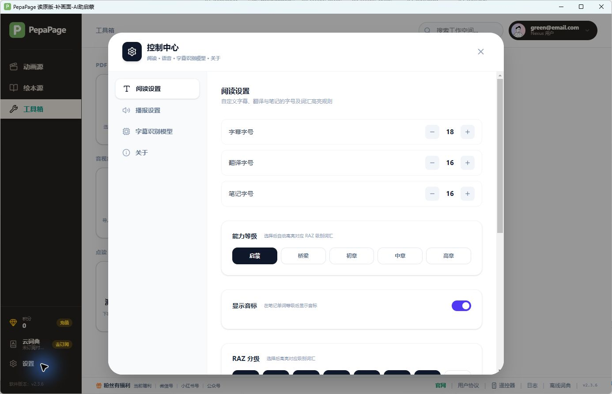
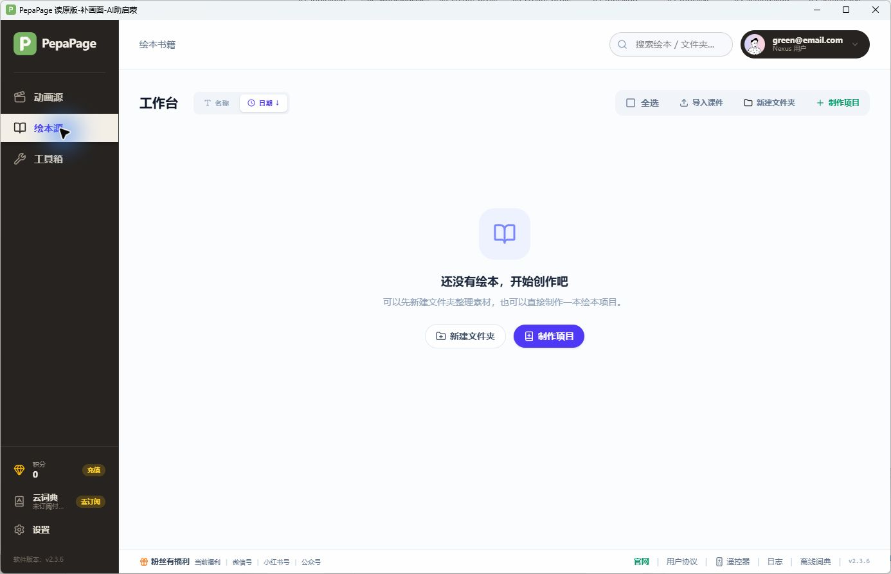
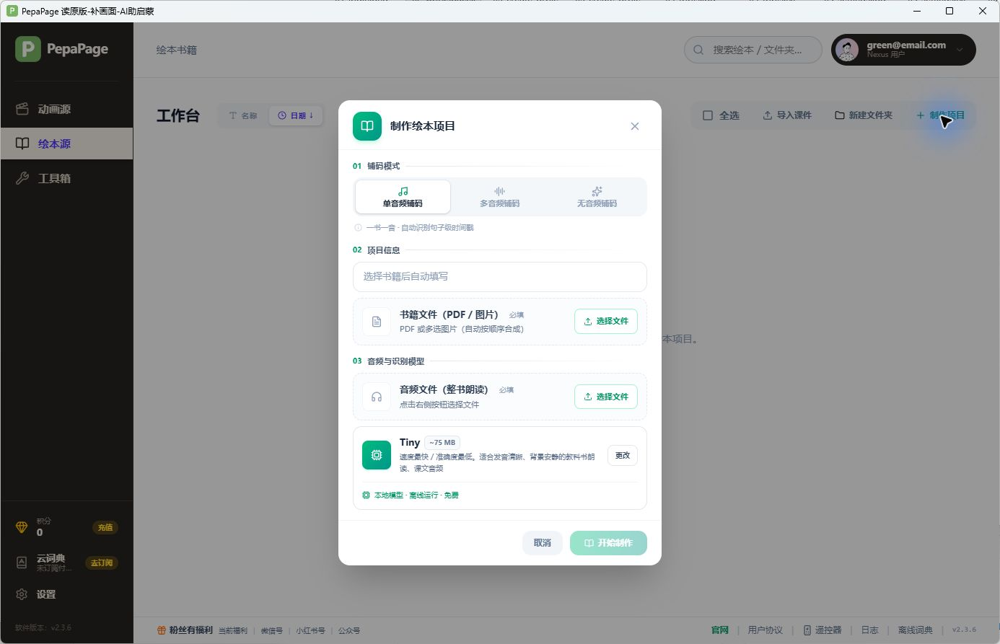
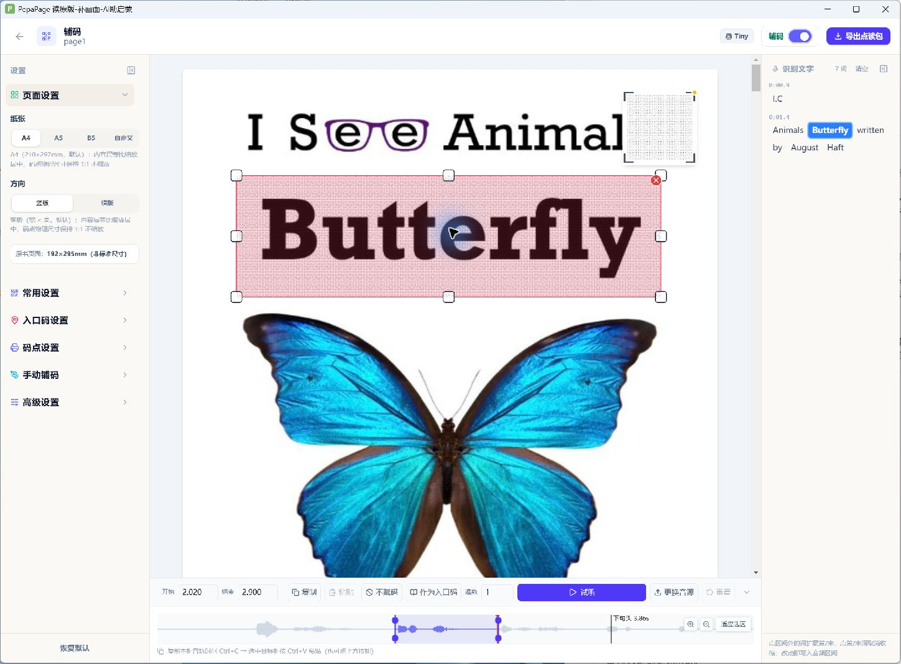
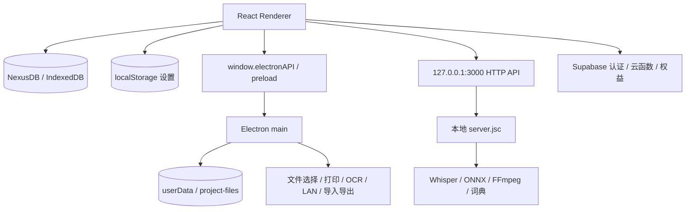

# PepaPage 2.3.6 Windows：逆向分析与复刻规格

分析日期：2026-10-30。目标：`PepaPage 读原版-补画面-AI助启蒙_Windows_2.3.6_x64.exe`。

**本期范围（用户最新决定）：优先复刻「绘本源」；「动画源」只保留导航与占位页，不实现其独立创建、台词本、字幕编辑等业务。** 具备有效阅读数据的绘本完成卡片仍进入共享阅读器，绘本可达的阅读与单词本不能随动画入口一起移除；默认手动multi的资格限制见4.8。已采集的动画相关证据保留作后续参考，不列入本期交付验收。工具箱本期只考虑绘本流程需要的裁剪、点读导出/转换等依赖，完整工具箱后置。

本文是后续复刻的入口，结合安装包解包、交付 JavaScript/CSS 静态分析、REA 证据和登录后的 Windows 实际界面。**这是复刻规格与证据清单，不是已经完成的一比一复刻，也不代表所有功能已实测。**

2026-10-30续分析：已经检查用户打开的现有single完成项目，新增16张截图，并成功导出一份绘本课件。完整结果见 [绘本源运行补证](analysis/runtime-20261030/README.md)；三模式创建到完成、课件往返、TTS与收费点读输出仍未验证。

## 1. 先读哪些文件

| 文档/资源 | 内容 |
|---|---|
| [本期绘本源复刻任务书](PepaPage-绘本源-本期复刻任务书.md) | **优先阅读**：用户确认的范围、实施阶段、截图与24项验收清单；动画源仅占位 |
| [本期绘本源页面专项规格](analysis/picture-book-ui-spec.md) | 本期优先：创建模式、状态、原书辅码编辑、校对、裁剪与导出 |
| [本期绘本源数据专项规格](analysis/picture-book-data-spec.md) | 本期优先：书籍/课件字段、制作管线、IPC、媒体目录与包格式边界 |
| [绘本源本轮运行补证](analysis/runtime-20261030/README.md) | 新增16张截图、现有项目数据实样、课件实际导出、REA证据与剩余缺口 |
| [前端页面与交互规格](analysis/frontend-findings.md) | 路由、工作台、阅读器、台词本、单词本、字幕编辑、排版实验室、点读、测验、快捷键、样式和默认值 |
| [数据与接口协议](analysis/data-contracts.md) | Dexie schema、媒体文件、HTTP 请求参数、云函数、浏览器插件及 LAN 协议 |
| [Electron 桥接清单](analysis/electron-ipc.md) | preload 暴露的方法与 IPC 通道、原文件行号 |
| [截图目录](analysis/screenshots) | 实际登录窗口、工作台、表单、工具箱、设置等界面参考；部分截图附可检索文本 |
| 上轮ASAR文件清单 `analysis/asar-inventory.json` | 上轮记录24,069个条目；当前工作区未找到该旧文件。本轮定向文件身份见 [提取清单](analysis/runtime-20261030/selected-artifacts.json) |
| [模型资源清单](analysis/model-resource-inventory.json) | 离线模型与关键数据资源的实际字节数 |
| [本轮REA证据索引](analysis/runtime-20261030/rea-index.json) | 记录已发布/部分/清理受阻状态与本地大文件位置。上轮约309MB的 `analysis/rea-evidence.json` 当前未找到，不能当成本轮可读证据 |

证据标签：**运行确认**表示实际观察到界面或行为；**静态确认**表示交付代码/资源存在该定义；**推断**表示据此提出的实现建议；**待验证**表示还没有相应运行证据。

## 2. 目标身份与提取结果

| 项目 | 结果 |
|---|---|
| 安装包字节数 | 1,011,597,815 |
| 安装包 SHA-256 | `9a7e4ea331e2537552e4b7f00807052522166455e4146de653d8ad7bb05dad22` |
| 安装器 | NSIS 3 Unicode，内嵌 `$PLUGINSDIR/app-64.7z` |
| 内层归档字节数 | 1,011,050,781 |
| 内层展开总量 | 2,679,409,497 字节，505 个文件、112 个目录 |
| 主程序 | `analysis/app/PepaPage.exe`，201,233,408 字节 |
| 应用归档 | `analysis/app/resources/app.asar`，597,579,681 字节 |
| ASAR SHA-256 | `dfefd44f6eff9af2bb475cae65749a654cdc65704c4b123d4556d26a02c79844` |
| package 声明 | `PepaPage-desktop`，版本 `2.3.6`，ES module |
| 主入口 | `dist-electron/electron/main.js` |
| Electron 运行版本 | `35.7.5`，运行时 User-Agent 确认 |
| Chromium 运行版本 | `134.0.6998.205` |

上表提取路径是上轮记录；当前工作区没有旧 `analysis/app/`、`analysis/asar/` 和完整旧REA证据。本轮从已安装的 `D:/systemSoft/PepaPage/resources/app.asar` 定向提取文件至本地 `analysis/runtime-20261030/static/`，完整代码与大证据不入Git；可审查的哈希和片段在本轮补证目录。不能把交付产物当成原作者源码工程：缺少原始TSX、工程配置和部分后端明文。

## 3. 产品全貌

PepaPage 是面向英语启蒙的素材加工与学习工作台。主要链路为：导入 PDF/视频/音频 → 本地或云端识别 → 字幕与页面映射 → 同步阅读、查词、笔记 → 台词本/单词本/绘本排版 → PDF、音频、课件或点读包导出。

还存在另一条独立链路：原书 PDF/图片 + 单/多音频或无音频 → OCR/音频匹配/自动配音 → 校对 → 手动/自动铺码 → 点读笔资源和打印文件。

不要将两条链路合并成同一个创建表单；不要把「绘本排版实验室」与「原书点读制作」当成同一编辑器。原创绘本元信息入口有“编辑器开发中”分支，也不能据此虚构一套已经发布的绘画编辑器。

完整路由表与每页交互见前端规格第 1–12 节。路由使用 HashRouter：桌面实际地址形如 `http://127.0.0.1:3000/#/tools`。

## 4. 登录后实测结果

本轮由用户手动完成登录，未保存密码或会话令牌到报告。观察账户当时积分为 **0**、云词典为 **未订阅付费词典**；这只是当时状态，不能写成所有用户的固定初始权益。

### 4.1 登录与空工作台

- 启动时登录弹层覆盖工作台，背景变暗并模糊。
- 登录弹层约 384px 宽，白底、约16px圆角，标题「登录账号」，副标题「欢迎回来，请登录你的账号」。
- 登录/注册分段切换；邮箱、密码、记住我（当时选中）；紫色全宽登录按钮。
- 登录后主导航为「动画源」「绘本源」「工具箱」，底部积分/充值、云词典/订阅、设置和软件版本。
- 动画源空状态文案「工作空间为空」；顶部与空状态中央均有导入课包、新建文件夹、制作项目。
- 绘本源空状态文案「还没有绘本，开始创作吧」，导入按钮文案为「导入课件」，与动画源「导入课包」不同。
- 日期排序按钮可切换 ↑/↓。工作台、绘本源的排序状态分别存在。

### 4.2 动画项目创建

实际弹层标题为「制作项目」，3列×2行的六种输入卡：

| 输入卡 | 实际副文案 |
|---|---|
| PDF | PDF + 音频 / 仅 PDF |
| 视频 | 导入视频自动识别 |
| 链接 | 下载远程视频 |
| 投屏 | 投屏 / 捕获屏幕 |
| 带字幕视频 | 跳过识别，用外部 SRT |
| 仅音频 | 音频 + 默认图 PDF |

视频模式默认选中，显示视频选择区域和字幕识别模型卡。初次模型加载时会短暂显示“尚未选择语音识别模型”；加载完成变为 **Tiny，~75 MB，本地模型·离线运行·免费**。这两个状态应分别还原，不能把加载中的占位当成最终状态。

未填输入时「创建」禁用；取消和关闭按钮可用。切换到 PDF 模式后出现 PDF 文档和音频选择区域；PDF-only 的后续处理分支见静态规格，不能由初始“音频必填”文案单独推断全部行为。

### 4.3 工具箱

实测 12 个入口，分三组：PDF 工具4项、音视频5项、点读3项。点读组两项是下载链接，一项是转换工具按钮，语义和 hover 反馈应分别处理。

PDF 裁剪、PDF 去阴影、PDF 转语音、PDF 打印；视频裁剪、批量掐头去尾、多音频合并、音视频下载、文字转语音；测码纸·图码一体、测码纸·图码分离、点读包转换。

卡片当时约160×160px、圆角16px、细灰边和轻阴影；图标为56px深棕方块中的白色线性图标。各组左对齐，不要横向均匀铺满可用空间。

### 4.4 控制中心

实际标题「控制中心」，四个左侧分组：阅读设置、播报设置、字幕识别模型、关于。面板约896px宽，桌面窗口内最大高度约90%，右侧内容独立滚动。

实测字号为字幕18、翻译16、笔记16；能力分启蒙/桥梁/初章/中章/高章；有显示音标开关、RAZ分级AA至Z2、固定搭配/美国当代英语语料库/中考/高考标签及导入字体。

### 4.5 绘本项目创建

绘本创建表单实测分为「单音频铺码」「多音频铺码」「无音频铺码」，有编号分区01铺码模式、02项目信息、03音频与识别模型。书籍支持PDF或多张图片；项目名提示「选择书籍后自动填写」。单音频模式的整书朗读音频必填，未选书籍时「开始制作」禁用。主色为绿色，与动画创建的模型紫色区分。

### 4.6 截图使用约定

Windows 标题栏约31px，不能当成网页内部顶栏。创建弹窗、工具箱、控制中心及绘本工作台截图为1386×893像素；早期工作台图为1275×893，可能受窗口位置裁切，应以完整截图及静态 class 共同校准。蓝色鼠标光晕来自取证工具，不属于产品设计。

所有截图只证明截图时的状态。尚无项目内容的页面不能用于断言字幕同步、分页和导出效果已经验证。

### 4.7 核心流程测试夹具与本轮边界

本小节记录范围调整前的动画样本准备，现已后置；本期绘本样本与验收见绘本源任务书。

已经准备 [5秒本地测试视频](analysis/fixtures/PepaPage-analysis-sample.mp4) 和 [配套SRT字幕](analysis/fixtures/PepaPage-analysis-sample.srt)。视频为640×360纯色画面和测试音，无人声；两条英文字幕分别位于0–2.4秒、2.5–4.9秒。这是本轮人工生成的测试夹具，不属于原应用默认素材，也不能用于评价语音识别准确率。

运行时已切换「带字幕视频」模式，确认界面显示「用户提供的SRT字幕」「免费」「跳过语音识别·完全信任您上传的字幕·不消耗积分」，并打开了本地视频文件选择框。后续输入遇到自动化工具的 `element … is not available in cached app state` 和 `user input was detected in this window`，刷新窗口后仍未可靠完成文件选择，因此停止输入。**动画夹具项目尚未创建；本段只记录当时尝试，绘本阅读入口和课件导出的后续实测见4.8，不能混同两类项目。**

下轮验证可直接使用这两个夹具：选择视频→选择SRT→检查项目名及创建启用态→创建→确认两句字幕和5秒时长→逐句跳转与播放→字幕编辑保存→台词本预览。应另加真实PDF/人声音频与多页长文本样本，覆盖分页和识别质量。

### 4.8 绘本完成项目续测

本轮复用已有 `page1` 单音频/Tiny完成项目，而非重新执行制作。确认完成卡片、更多菜单、解析详情两页签、辅码三栏、开关与点阵、选框联动识别词、停靠底部音轨，以及卡片进入共享阅读器并返回绘本源。多音频/无音频表单现也有真实截图，TTS默认Bella/1.0x。

数据实样为13页、OCR26句/39块、字幕2条、7个词时间；卡片“字幕26”并非字幕条数。精确行句映射matchedCount0与句级音轨对齐matchedCount2并存，不能把不同映射当成同一成功指标。

工作台全选后通过“导出课件”成功保存 `.nexusbookpkg`（2,234,925字节）；可按UTF-8解析外层JSON，包含version1、protection和metadata，内部加密载荷未恢复，不能当普通ZIP或内部manifest直接读取。收费点读导出另显示200积分，在当前余额0时确认禁用；没有扣费或生成点读文件。

静态补证同时修正两处范围：仅单PDF选择会附同目录同basename音频，图片不附；默认手动multi缺有效音频页映射时不能进入阅读器，不能用completed状态保证所有绘本可读。上述静态限制尚未全部运行复现。

新增截图为1449×1069，账号区域已遮盖。原项目辅码开关已恢复关闭，原书、音轨和识别文字未编辑，应用留在绘本源。截图、文件摘要、REA IDs及限制统一见 [运行补证](analysis/runtime-20261030/README.md)。

## 5. 技术架构与桌面边界

静态确认：React 19 + React Router 7 + Vite + Tailwind；Dexie/IndexedDB 保存业务数据；Electron preload 暴露桌面能力；Express 本地服务提供前端及媒体/AI处理；Supabase 客户端提供认证及云端业务。

主窗口默认1400×900，最小1024×700；原生标题栏，隐藏应用菜单。`main.js:392` 起可复核。生产前端加载 `127.0.0.1:3000`，开发模式为5173。启动先等待 `/api/health`，Windows超时60秒；失败有独立错误窗口。

应用同时开启两份会争用3000端口，本轮第二次启动观察到 `EADDRINUSE`。复刻时应加入单实例/端口处理，而不是把该异常当成正常产品页面。

原主进程配置含 `contextIsolation:true`、`nodeIntegration:false`、`webSecurity:false`、`sandbox:false`。这些是观察值，不是建议照抄所有安全配置；UI与功能一致并不要求复制这些实现细节。

## 6. 本地目录与持久化

来源：`main.js:119–163`、`lib/portable.js`、`lib/projectFiles.js`。

- portable标记/文件名包含portable：使用exe同级 `user-data`。
- Windows正常安装且安装目录可写：若同盘根目录已有 `PepaPage-data`，优先使用；否则exe同级 `user-data`。
- 其他情形保留系统userData路径；存在旧数据迁移逻辑。
- **本轮解包运行的实际数据目录可能被上述代码重定向，不能假设命令行 `--user-data-dir` 一定生效。**
- `project-files/<projectId>/` 保存PDF、音频、视频、字幕、封面和时间戳；`settings.json`保存主进程键值；`runtime-config.json`传递运行配置；`logs/server.log`记录日志；`whisper-models/`保存用户模型。
- Dexie库为 `NexusDB`，最高schema版本20，10张业务表。具体索引及迁移见数据协议。
- 大媒体与业务metadata分开保存，不能把全部媒体塞进React state或JSON；前端文件保存有2MiB分块逻辑。

## 7. 模型、媒体和素材

| 组件 | 包内证据 | 复刻用途/确认范围 |
|---|---|---|
| Whisper Tiny | `bin/ggml-tiny.bin`，77,691,713字节，多个CPU指令集CLI | 本地语音识别；界面模型卡已实测，识别精度未测 |
| wav2vec2-base-960h | `models/alignment/.../model.onnx`，377,798,305字节 | 强制对齐候选组件；worker核心为字节码，不能仅凭模型名推出算法细节 |
| KittenTTS Micro 0.8 | ONNX约41.4MB、voices.npz约3.28MB | 本地英文配音 |
| OPUS-MT en-zh | 量化encoder约52.9MB、decoder约60.2MB | 离线英译中 |
| Paddle OCR v6 small | 检测、识别模型与字典 | OCR文本框/句行提取 |
| DocLayout/SLANet | 两种版面模型、表格模型 | 结构化文档识别 |
| 说话人分离 | segmentation-3.0、embedding-resnet34、PLDA | 存在模型资源，效果及实际触发条件待测 |
| dictionary.db | 77,664,256字节 | 本地词典数据；报告未复制整库词条 |
| FFmpeg / ffprobe / yt-dlp | node_modules解包二进制与 `bin/win/yt-dlp.exe` | 转码、抽帧、裁剪、探测和下载 |
| SumatraPDF | `bin/win/SumatraPDF.exe` | Windows静默PDF打印 |
| oid-lib.dat | 20,774,018字节 | 点读相关数据；不是已经解码证明的协议 |

前端素材已提取：品牌PNG/SVG、默认封面、Baloo2/Virgil/中文字体、三种插图风格样张、云词典插画、世界与七洲地图、测码纸PDF。后续复刻可直接用这些文件做本地视觉对照，不应重新猜测已有图形形状。

## 8. 已恢复与未恢复的实现

**可直接阅读**：Electron main/preload、LAN服务、打印辅助模块、项目路径、便携模式、前端打包JS/CSS、插件协议、模型配置。

**只有V8字节码**：`server.jsc`、保护课包导入导出、加密、绘本课件、OID库、NOB打包、付费导出guard、OCR/结构识别核心、对齐/翻译/短语worker等。没有把这些文件还原成可靠源码。

因此可恢复调用边界和输入输出消费逻辑，但不能声称已恢复原后台全部算法、云端函数实现、支付事务、包密码学或点读编码器。复刻应自行实现同等功能，付费权益接自建服务，不能用伪造成功响应替代完整处理。

REA静态分析只选择了package、preload、LAN和两个路径辅助模块；完整归档被识别，但22340个相关文件未纳入该轮源分析，语义unknown还达到保留上限。前端规格另外来自直接阅读交付构建产物，不能把REA部分图误称成全代码语义覆盖。

主要REA证据：

- 静态父记录 `ev_57854e79bc0b03fceeb6af897703db9e29d236a21bb197a6205a79426133862f`。
- 登录截图 `ev_9440a4015d9d9874cde11267ff1d53fbefb367dc0a8a4f1ac84abeb67f76f726`。
- 原生Electron渲染页面被动观察 `ev_c3111fbe389b9aae886a8e9dddb9fdaed401596fdde78324d31349156c2cd58a`。

## 9. 后续复刻的执行顺序

1. **绘本源壳层与视觉基线**：Electron窗口、HashRouter、184px侧栏、顶栏、页脚和必要登录态；实现绘本工作台及文件夹。动画源点击进入占位页，本期不接动画业务。相同窗口尺寸下与绘本截图对比。
2. **绘本项目创建与持久化**：`bookFolders/books/bookProjects`、书籍PDF/多图导入、单音频/多音频/无音频三种表单；输入校验、自动命名、媒体复制、封面与卡片。
3. **制作管线与校对**：书籍解析、OCR、转码、识别、句子对齐/文件名映射；按模式展示步骤、进度、失败重试、待校对及完成状态。无音频模式先校对、再合成语音。
4. **绘本阅读与原书辅码编辑**：具备有效阅读数据的完成卡片进入共享阅读器并返回绘本源，保留默认手动multi缺映射的错误；原PDF页面和识别框、音轨/波形、时间裁剪试听、矩形/圆形手工区域、音频拖入、入口码、跳过赋码、重复、替换音频及布局持久化。
5. **绘本导出闭环**：绘本课件导入导出、内容PDF/点码PDF/点读ZIP及必要转换；核对码值分配、页面缩放与码点物理尺寸。DAB/NOB与实体点读笔分别验收。
6. **依赖与完善**：接入该流程所需裁剪、离线模型/TTS、词典/单词本与真实导出服务；云端权限和收费功能按实际需要实现并单独验收。其他工具、完整云端业务和动画源后置。

这里是按本期用户范围提出的复刻顺序，不是对原工程目录或研发历史的断言。动画项目中的「绘本排版实验室」仍属于动画链路，本期不因名称包含“绘本”而纳入绘本源。

## 10. 验收用例与仍需补证

以下保留全产品证据状态；**本期以绘本源专项规格中的验收表为执行清单，动画相关行暂不验收。**

| 验收场景 | 本轮证据状态 | 后续判定标准 |
|---|---|---|
| 登录前后、三页导航、空状态 | 已运行观察 | 同窗宽下布局、文案、激活态与截图一致 |
| 六种动画输入、三种绘本铺码 | 表单实测 + 静态分支 | 每类必填、禁用态、取消和队列行为一致 |
| Tiny等模型与默认设置 | 界面实测 + 包内模型 | 模型卡、占位、切换、离线识别结果分别验证 |
| 有数据项目卡与多选 | 静态确认，待完整运行 | 搜索排序、移动、删除确认、导出菜单和重新打开不丢数据 |
| 同步阅读、字幕编辑 | 静态确认，待样本运行 | 边界seek、前后句、重复、播放速度、拆合后保存正确 |
| 台词/单词/绘本分页导出 | 静态确认，待输出比对 | 同纸型页数、换行、图片裁切、字体与预览一致 |
| AI、付费词典、云端识别 | 当前账户无积分/未订阅，未调用 | 成功与失败返回、额度、取消和扣费时点有实际证据 |
| 受保护课包、DAB/NOB、OID | 桥接/资源确认，核心字节码 | 自建格式互操作及实体设备识别；不能只比较文件后缀 |
| HID、LAN、打印 | 静态协议确认，未触发设备操作 | 真实遥控器、手机、打印机验收 |

本次未购买权益、未调用扣费生成、未实际打印、未改打印机设置、未连接HID设备、未尝试绕过授权或解密保护机制。对完整一比一的效果承诺，需要在以上待验证项补齐样本和设备证据之后再作判断。
