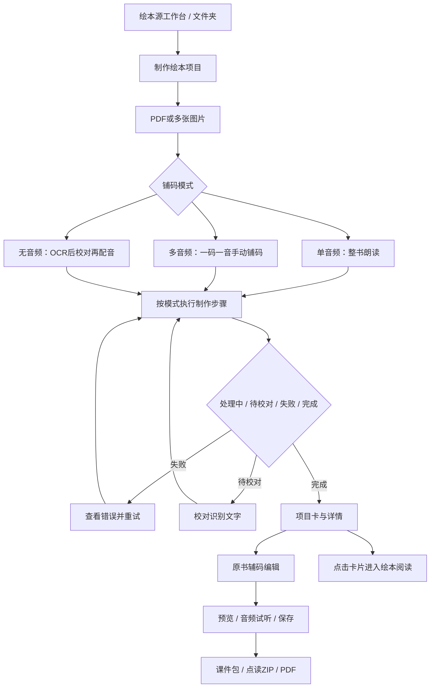
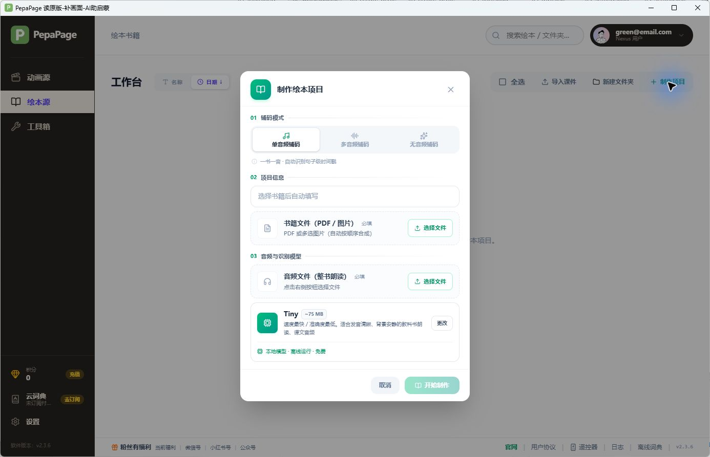

# PepaPage 绘本源：本期复刻任务书

依据：PepaPage Windows x64 2.3.6 安装包、提取后的前端与 Electron 代码、登录后界面观察。分析日期：2026-10-30。

**本期以「绘本源」为主；「动画源」保留导航和占位页。本文是开发范围与验收入口，尚未开始编写复刻应用。**

## 1. 先看这三份文档

| 文档 | 使用方式 |
|---|---|
| [绘本源页面、交互与编辑器规格](analysis/picture-book-ui-spec.md) | 设计和前端实现依据：表单、状态、操作、辅码编辑、导出配置 |
| [绘本源数据、处理管线与接口](analysis/picture-book-data-spec.md) | 数据与桌面实现依据：字段、模式、处理步骤、IPC与课件包 |
| [总分析报告](PepaPage-2.3.6-逆向分析与复刻规格.md) | 安装包身份、架构、截图、资源、证据边界与全产品背景 |

专项文档中的构建产物字符偏移用于定位证据；不是可直接编译的原始 TypeScript 源码。**静态确认**只表示代码存在相关分支，**运行确认**才表示本轮观察到对应界面或行为。

## 2. 范围约定

| 模块 | 本期处理 |
|---|---|
| 主框架 | 保留品牌、184px侧栏、顶栏、页脚、必要账户/设置入口 |
| 绘本源工作台 | 实现项目、文件夹、搜索、排序、多选及项目状态 |
| 绘本制作表单 | 实现单音频、多音频、无音频三种模式及各自必填和选项 |
| 制作过程 | 实现解析、OCR、音频处理、识别、匹配、校对、重试与完成状态 |
| 原书辅码编辑 | 实现页面、区域、音轨、试听、时间调整、入口码及保存 |
| 绘本阅读 | 完成卡片点击进入共享阅读器，返回绘本源；动画导航占位不影响这条绘本可达路径 |
| 绘本课件与点读导出 | 实现真实导入导出；点读格式及设备兼容性另以实际样本验收 |
| 绘本相关裁剪/单词本 | 按绘本源可达入口实现，详细依赖见专项文档 |
| 动画源 | 导航可点击；进入明确的待开放占位页，不接动画处理任务 |
| 动画源里的绘本排版实验室 | 后续范围；不因名称含“绘本”而混入本期 |
| 完整工具箱、支付、其他云端功能 | 后置；本期只接绘本闭环实际需要的依赖 |
| 原创绘本绘画编辑器 | 原版存在“开发中”提示，不能把一套虚构编辑器作为原版需求 |

占位页具体文案是本期新产品决定，原版没有提供对应占位截图；不要将新文案标成原版实测内容。

## 3. 用户流程与页面清单

流程图概括已发现的分支，不表示三种模式会执行完全相同的任务。跳过步骤、等待校对与继续制作的具体条件以数据专项规格为准。

当前多音频创建表单不传 `multiAudioAlign`，因此走手动铺码；`asr/filename` 是底层兼容分支，不能在本期表单自行增加相应模式按钮。完成的绘本卡片主体点击会进入共享 `/reader/:id`，解析详情位于更多菜单；共享阅读器和由绘本可达的单词本仍属绘本流程，不能随动画源一起移除。

| 页面或弹层 | 关键内容 | 本轮证据 |
|---|---|---|
| 绘本源空工作台 | 导入课件、新建文件夹、制作项目、排序、全选 | 运行确认及截图 |
| 制作项目：单音频 | 01铺码模式、02项目信息、03音频与识别模型 | 运行确认及截图 |
| 制作项目：多音频/无音频 | 多文件、匹配策略、配音设置、校验 | 静态确认；具体见专项规格 |
| 项目有数据状态 | 状态、步骤、封面、页/音频/映射统计、菜单 | 静态确认 |
| 校对结果 | OCR文字、确认、继续配音/重对齐 | 静态确认 |
| 原书辅码编辑器 | 页面、文字/图片框、音轨、入口贴纸、导出设置 | 静态确认 |
| 绘本阅读器 | 完成卡片进入，源书/音频/字幕同步，返回绘本源 | 静态确认；复用的组件仍需实现 |
| 导入/导出完成与错误 | 包格式、资源恢复、取消、失败提示 | 静态确认；输出互操作待测 |

## 4. 视觉对照

使用原版默认1400×900窗口作基线，最小窗口1024×700。两张绘本截图实为1386×893像素，不能直接把图像每一个像素当成CSS像素。原生标题栏不属于网页内部布局，蓝色鼠标光晕不属于原版设计。

主框架配色与尺寸见 [通用前端规格](analysis/frontend-findings.md) 第2节；绘本源详细组件见页面专项规格。绘本创建以绿色为主，模型加载占位、最终模型卡及禁用态应分别实现。

目前尚无完成项目的编辑器实测截图。其布局和交互可先依交付代码实现，但不能据此声称已完成编辑器像素对比。

## 5. 开发拆分与完成标准

| 阶段 | 输出 | 完成标准 |
|---|---|---|
| 1. 页面与工作台 | 壳层、绘本首页/文件夹、三种创建表单、动画占位 | 与已有截图对齐；模式切换和输入禁用态正确 |
| 2. 项目与媒体 | 三张绘本相关数据表、本地媒体目录、导入和任务记录 | 重新打开应用后项目与资源可恢复，错误可见 |
| 3. 制作管线 | 三模式真实处理、进度、等待校对、重试与重对齐 | 用不同输入样本完成正确分支，不使用定时器伪造处理成功 |
| 4. 阅读、编辑与保存 | 绘本阅读、页面、识别框、手动区域、音轨试听、起止时间、入口配置 | 交互与数据联动；从绘本进入并正确返回；保存重开不丢修改；坐标与时间单位一致 |
| 5. 课件与导出 | 课件包、PDF与点读资源；必要转换入口 | 导出文件可实际打开；课件往返后内容与区域一致；点读需实机通过 |

不必复刻原版的压缩变量名、内部组件命名或脆弱实现细节；一比一主要以界面、交互、数据结果和输出互操作判定。涉及V8字节码的后端核心需自行实现，并用真实输入输出核验。

## 6. 本期验收清单

以下是待执行的复刻验收，不是本轮原版测试通过记录。

| 编号 | 场景 | 判定标准 |
|---|---|---|
| PB-01 | 动画源导航 | 只进入占位页，不创建动画项目或开启相关任务 |
| PB-02 | 绘本空状态 | 导航激活、面包屑、按钮、空文案与截图一致 |
| PB-03 | 文件夹 | 创建、进入、返回、多级移动及搜索排序行为正确 |
| PB-04 | 三种模式切换 | 字段、必填、说明及按钮状态随模式变化 |
| PB-05 | PDF导入 | 自动名称、页数、顺序、封面与文件路径正确 |
| PB-06 | 多图导入 | 页序可重复验证；合成页面与原图一致，取消无半成品误报 |
| PB-07 | 单音频 | 音频转换、识别、句框匹配、时长和字幕统计正确 |
| PB-08 | 多音频创建默认值 | 当前表单不增加ASR/文件名匹配控件，创建默认走手动分支 |
| PB-09 | 多音频资源列表 | 按原文件名自然排序，音频可试听、复用并显示已放置位置 |
| PB-10 | 多音频手动映射 | 不强制走自动OCR/ASR，能手工建框绑定音频 |
| PB-11 | 无音频 | OCR后停在待校对；确认后才合成音频，输出逐句资源 |
| PB-12 | 错误与重试 | 解析/识别/配音失败显示原因；重试不重复创建项目 |
| PB-13 | 仅重对齐 | 保留必要源资源与已校稿文本，按实际分支更新映射 |
| PB-14 | 辅码区域 | 矩形/圆形创建、移动缩放、选择与删除操作及保存正确 |
| PB-15 | 音轨与试听 | 起止时间、波形、复制粘贴、上句尾/下句头与试听一致 |
| PB-16 | 特殊音频 | 跳过赋码、入口码、重复次数、自定义替换与重置正确 |
| PB-17 | 码点与版面 | 内容缩放时码点物理尺寸保持要求；页内坐标一致 |
| PB-18 | 导出课件再导入 | 书页、音频、文本、框、辅码配置和当前用户归属正确恢复 |
| PB-19 | 点读ZIP/PDF | 内容层、码点层、入口音频和按码值命名音频均可检查 |
| PB-20 | DAB/NOB与实体设备 | 格式结构和点读行为实际兼容，不能仅更改扩展名 |
| PB-21 | 重启恢复 | 工作台状态、书页和编辑结果可再次打开 |
| PB-22 | 导出取消/失败 | 不误报成功；收费场景另核对授权和实际扣费时点 |
| PB-23 | 绘本阅读入口 | 点击完成卡片进入共享阅读器，内容同步且可返回绘本源；更多菜单详情保持独立 |
| PB-24 | 绘本影子项目与单词本 | 共享阅读/词本数据正确；影子项目不在动画工作台作为真实动画重复展示 |

## 7. 现有夹具与待补证据

已准备 [两页绘本PDF夹具](analysis/fixtures/PepaPage-picture-book-sample.pdf)：第一页英文句子与绿色方形，第二页英文句子与蓝色矩形。它是人工生成的测试文件，不是原版内置绘本；尚未完成原版导入。

后续需要真实样本覆盖：扫描PDF、带原生文字PDF、横竖混排页面、多张图片、单一整书音频、多条可按文件名匹配的音频、无音频绘本及一份可往返导入导出的课件。真实朗读音频才能评价识别和对齐；短合成提示音不能替代。

核心待补证据包括完成项目截图、校对前后变化、辅码拖动与波形行为、导出文件样本、DAB/NOB与实体点读笔兼容性。付费云端功能和V8字节码算法尚未完整实测或恢复，详见总报告边界。
