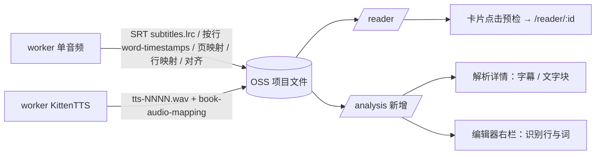

# 阅芽绘本单音频闭环（附 TTS 修正）实施计划

本文是交给新会话执行的实施文档。先读第 1–5 节，再按第 6 节逐个 Task 实现。每个 Task 写明了改动文件、做法、测试、验证命令和提交信息。行号来自 2026-10-30 的代码，实现前请再确认一次。

依据：`PepaPage-绘本源-本期复刻任务书.md`、`analysis/picture-book-data-spec.md`、`analysis/picture-book-ui-spec.md`、`analysis/runtime-20261030/README.md`、`analysis/runtime-20261030/static-findings.md`、`analysis/runtime-20261030/project-observation.json`、截图 `analysis/screenshots/08`–`23`、`docs/team-contract.md`。

## 1. 当前状态（2026-10-30）

> 2026-10-31 更新：12 个 Task 已全部提交，验收记录见 `analysis/replica-acceptance-2026-10-31.md`。本节以下内容是开工前的状态，保留作记录。

- HEAD 是 `9adab63 docs: 完善绘本源运行验证与 REA 分析证据`。三端代码都还没改，Task 1 尚未开始。
- `yueya-worker/.venv` 已建好：Python 3.12.6，只装了 pytest 9.2.0 和 numpy。现有 8 个测试全部通过：
  `cd yueya-worker; .\.venv\Scripts\python.exe -m pytest -q tests`
- 本机工具链：Java 21.0.10、Maven 3.6.3（Spring Boot 3.4.5 要求的最低版本）、Node 22.23.4、npm 12.2.1。
- `yueya-server` 的 pom 里已有 `spring-boot-starter-test`，但没有 `src/test` 目录。
- `yueya-web` 下没有 `node_modules`，第一次构建前先执行 `npm ci`。前端没有测试框架，验证靠 `npm run build`。

## 2. 工作规则

- **一个 Task 一次提交**：该 Task 的测试或构建通过后立即提交，不要等全部写完。
- 提交信息用 Conventional Commits 前缀加中文描述，各 Task 的提交信息见第 6 节。
- 只提交本 Task 相关的文件。不要 push，不要改写历史。不要提交 `.env`、`.venv/`、`node_modules/`、KittenTTS 模型文件和 REA 大证据。
- 验证失败就先修到通过再提交，不要把失败状态提交上去。
- 环境限制：
  - 权限规则禁止 PowerShell 的 `Get-ChildItem` 和 `Test-Path`。列目录用 list_directory 工具，找文件用 file_search。
  - web_fetch 不能访问 github.com，可以用 web 搜索，或者访问 huggingface.co。
  - 一次装完 `requirements.txt` 超过 20 分钟，曾被中断。只在需要跑 smoke 端到端时再装完整依赖，并放到后台执行。
  - 原版安装目录 `D:/systemSoft/PepaPage` 不在工作区内，读取或复制之前先问用户。

## 3. 范围

| 做 | 不做 |
|---|---|
| 单音频从创建到阅读的整条流程：字幕、词时间、对齐、映射、阅读器、解析详情、辅码编辑器 | 积分、余额、扣费。现有"预计消耗 N 积分"文字保持原样，不加积分确认弹窗 |
| TTS：状态流转修复、阅读器报错、引擎换成 KittenTTS | 多音频的任何改动，包括手动绑定的存储方式、资源排序和多音频的前端表现 |
| 工作台卡片、菜单、创建表单的书源校验 | 卡片"裁剪""单词本"按钮和批量"导出单词本"，也不放占位按钮 |
| 新增服务端 JUnit 测试，扩充 worker pytest | 课件导入、识别原版加密课件。`CoursewareService` 不动 |

服务端阅读器统一补上的空序列报错会顺带覆盖 multi，这是预期行为，前端不为 multi 做额外处理。

## 4. 原版目标文件格式

依据是 `analysis/runtime-20261030/project-observation.json`（单一 Tiny 完成项目，13 页、OCR 26 句 / 39 块、字幕 2 条、词 7 个）。

**写出一律用新结构。读取同时兼容新旧两种结构**，这样旧 worker 生成的项目不用重跑也能打开。

### 4.1 新结构（写出）

`subtitles.lrc`：文件名不变，内容是 SRT 文本。

```
1
00:00:00,940 --> 00:00:01,250
Hello

2
00:00:01,500 --> 00:00:02,900
Butterfly ...
```

`word-timestamps.json`：顶层只有 `version` 和 `words`，键是字幕行号字符串（0 起始）。

```json
{"version":1,"words":{"0":[{"text":"Hello","start":0.94,"end":1.25}],"1":[{"text":"Butterfly","start":2.02,"end":2.9}]}}
```

`book-alignment.json`：结构不变。

```json
{"version":1,"sentenceCount":26,"matchedCount":2,"mode":"word","alignments":[{"sentenceIndex":0,"start":-1,"end":-1,"confidence":0,"words":[{"start":-1,"end":-1,"confidence":0}]}]}
```

`book-page-mapping.json`：`mappings` 是"行号字符串 → 0 起始页"的对象。

```json
{"version":1,"lineCount":2,"pageCount":13,"mappings":{"0":0,"1":0},"tailRefinedCount":0}
```

`book-line-ocr-mapping.json`：未命中时 sentenceIndex 和 pageIndex 为 -1，score 为 0。

```json
{"version":1,"lineCount":2,"sentenceCount":26,"matchedCount":0,"entries":[{"lineIndex":0,"sentenceIndex":-1,"pageIndex":-1,"score":0}]}
```

### 4.2 旧结构（只读兼容，来自当前 worker）

| 文件 | 旧结构 |
|---|---|
| subtitles.lrc | 方括号 LRC：`[mm:ss.xx]text` |
| word-timestamps.json | `{version, model, language, words:[{text,start,end,probability}], segments}`，words 是平铺数组 |
| book-page-mapping.json | `mappings:[{lineIndex,pageIndex,start,end,text,score}]` |
| book-line-ocr-mapping.json | `mappings:[{lineIndex,start,end,text,sentenceIndexes:[...]}]` |

### 4.3 页码基准

| 位置 | 字段 | 起始 |
|---|---|---|
| book-ocr.json | `pages[].index`、`sentences[].pageIndex`、`blocks[].pageIndex` | 1 |
| book-ocr.json | `sentenceIndex` | 0 |
| book-page-mapping.json | `mappings` 的值 | 0 |
| book-line-ocr-mapping.json | `entries[].pageIndex` | 0（**未经原版样本验证**，样本里只有 -1）；-1 表示未命中 |
| book-audio-mapping.json | `entries[].pageIndex` | 1（数据规格 5.3） |
| 编辑器 boxKey `p<page>:s<i>` | page | 1 |
| `/reader` 的 cues 和 clips | `pageIndex` | 1 |
| 新接口 `/analysis` | `lines[].page`、`pages[].index` | 1 |

## 5. 关键决定

1. **单音频固定读原始 `book-ocr.json`。** 原版对齐 `rSe` 读的是原始 OCR，所以阅读器的单音频分支和 `/analysis` 的单音频分支也读原始 OCR，避免句号与校对后的 OCR 错位。
   - 后果：单音频做了校对之后，重对齐和阅读结果都不变。
   - 数据规格第 6 节说阅读器会读校对后的 OCR，这个决定与它不一致，用户已确认采用。要在 `docs/team-contract.md` 里注明。
   - TTS 和 multi 继续优先读 `book-ocr-reviewed.json`。
2. **行映射的 pageIndex 用 0 起始**，与页映射一致。代码注释和契约里都写明"未经原版样本验证"。
3. **阅读器资格检查**：卡片点击时先请求 `/reader`，成功才跳转到 `/reader/:id`。失败就在工作台显示服务端返回的原版错误文字。
4. **新增 `GET /api/book-projects/{id}/analysis`**：服务端解析字幕，合并页映射、行映射、对齐、词时间和 OCR 后返回给前端，供解析详情和编辑器右栏共用。前端不直接拉取 OSS 上的文本文件，也就没有 CORS 问题。
5. **TTS 状态流转**（数据规格第 7 节的 `fse` 与 `xF`）：
   - 已完成的 TTS 项目执行"按校稿重新配音"：第 3 步设为 pending、进度 0，`ocrConfirmed=true`，`currentStepIndex=3`，投递 `book_tts`。
   - retry 和 fullRetry 遇到 TTS 项目时把 `ocrConfirmed` 设为 false，让项目能重新进入"待校对"。
   - 单音频保留 `hse` 规则：前三步全部 completed 才只重置第 3 步，skipped 不算 completed。
6. **KittenTTS**：以下是已查到的事实。
   - 原版自带 `models/kitten-cache-micro/{config.json(493B), kitten_tts_micro_v0_8.onnx(41MB), voices.npz(3.3MB)}`，见 `analysis/model-resource-inventory.json`。
   - KittenTTS 0.8 的 8 个声线正好是 Bella、Jasper、Luna、Bruno、Rosie、Hugo、Kiki、Leo，与原版表单一致，可以调语速，输出 24 kHz。来源：[KittenTTS ONNX 模型文档](https://github.com/KittenML/KittenTTS/blob/main/docs/onnx-models.md)、[kitten-tts-mini-0.8 模型卡](https://huggingface.co/KittenML/kitten-tts-mini-0.8)。
   - Python 包名是 `kittenml`。文档说默认安装会带上 KittenTTS 2 需要的 PyTorch；只跑 0.8 ONNX 模型时，可以用 `--no-deps` 安装，再另装 onnxruntime、espeakng_loader、phonemizer、soundfile、numpy、huggingface_hub。
   - 尚未确认的两点：`KittenTTS(...)` 能否直接加载本地模型目录（文档示例用的是 Hugging Face 仓库名）；`espeakng_loader` 是否让 Windows 不用再单独安装 espeak-ng。Task 6 第一步先验证这两点。
   - 缺模型或缺音素库时明确报错，不回退到 SAPI。pywin32 依赖随之移除。



## 6. 任务

建议按编号顺序执行。前端 Task 8 和 Task 11 依赖 Task 5 的 `/analysis` 接口。

### Task 1：worker 字幕与词时间改为原版格式

改动文件：新建 `worker/subtitles.py`、`tests/test_subtitles.py`；修改 `worker/asr.py`、`worker/pipeline.py`、`tests/test_units.py`。

做法：

1. 新建 `worker/subtitles.py`，包含三个函数：
   - `to_srt(segments) -> str`：
     - 时间格式 `HH:MM:SS,mmm`，毫秒用 `round(t*1000)`，负数按 0 处理。
     - 每条字幕依次是序号、时间行、文本；字幕之间空一行，文件末尾换行，换行符用 `\n`。
   - `parse_subtitles(text) -> list[{index,start,end,text}]`：
     - 先去掉开头的 `\ufeff`，把 `\r\n` 和 `\r` 统一成 `\n`。
     - 只要有一行匹配 `(\d+:)?\d{1,2}:\d{1,2}[,.]\d{1,3}\s*-->\s*(\d+:)?\d{1,2}:\d{1,2}[,.]\d{1,3}`，就按 SRT 解析：
       - 按空行切块，每块找时间行，序号行可有可无。
       - 时间行之后的文本行用空格拼接，并去掉 `<...>` 标签。
       - 保留真实的结束时间。
       - 按文件顺序输出，不排序。`index` 是输出位置（0 起始），文本为空的字幕也保留，这样行号与 word-timestamps 的键对得上。
       - 1–2 位毫秒按小数理解，例如 `,5` 是 0.5 秒。
     - 否则按 LRC 解析，沿用现有正则 `\[(\d+):(\d+(?:\.\d+)?)\]`：
       - 一行有多个时间标签时生成多行。
       - 内容为空的时间标签当作上一行的结束时间。
       - 按 start 排序；end 默认取下一行的 start，最后一行加 3 秒。
     - 两种格式都不是时返回空列表。
   - `flatten_words(words) -> list[{text,start,end}]`：
     - dict：按数字键排序后展开，非数字键排在数字键之后。
     - list：原样返回，只过滤掉非 dict 项。
     - 其他类型：返回空列表。
     - 缺少数字 start 或 end 的词丢弃。
2. 修改 `worker/asr.py`：
   - `transcribe` 改为返回 `{"segments":[{start,end,text}], "words":{"<行号>":[{text,start,end}]}, "language"}`。行号是保留下来的 segment 下标。文本为空的 segment 连同它的词一起丢弃，并去掉 probability 字段。
   - 删除 `_fmt`、`to_lrc`、`parse_lrc`。仓库里调用它们的只有 `pipeline.py` 和 `tests/test_units.py::test_lrc_roundtrip`，已用 grep 确认。
   - 模块说明改为"输出 SRT 字幕与按行分组的词级时间"。
3. 修改 `worker/pipeline.py`：
   - `step_transcription`（约 115–124 行）：
     - `subtitles.lrc` 写入 `subtitles.to_srt(res["segments"])`。
     - `word-timestamps.json` 只写 `{"version":1,"words":res["words"]}`，因为原版样本的顶层只有这两个键。
     - `metadataPatch.asrModel` 保留不变。
   - `run_single_alignment`（约 127–142 行）：
     - 用 `decode("utf-8-sig")` 加 `parse_subtitles` 读取字幕。
     - 解析出 0 行时抛 `StepError("subtitles.lrc 无法解析出字幕行（内容既不是 SRT 也不是 LRC）")`，避免像现在这样静默得到空结果。
     - 词时间用 `flatten_words(wt.get("words"))` 展开后传给 `align(ocr, rows, words or None)`。

测试：放在 `tests/test_subtitles.py`，原 `test_lrc_roundtrip` 迁过来。`test_units.py` 里不再用到的 `asr` import 要删掉。

- `to_srt` 输出 2 条样本字幕：结果包含 `1\n00:00:00,940 --> 00:00:01,250\nHello`，再解析回来的数值一致。
- 3725.5 秒格式化为 `01:02:05,500`。
- 带 BOM 和 CRLF 的 SRT 能正常解析。
- LRC 兼容：`[00:01.20]hi\n[01:05.50]yo\n` 的 start 分别为 1.2 和 65.5，第一行 end 为 65.5，最后一行 end 为 68.5。
- LRC 结束标记：`[00:01.00]hi\n[00:02.50]\n` 的 end 为 2.5。
- 随意文本返回 `[]`。
- `flatten_words`：
  - `{"10":[...],"2":[...]}` 先展开 2，再展开 10。
  - list 原样返回。
  - None 返回 `[]`。
- `asr.transcribe`：用 monkeypatch 替换 `asr._model`，返回假的 segment（含一个空文本 segment）。断言 words 的键和 segments 一一对应。
- `run_single_alignment`：用 `LocalStorage(tmp_path)` 写入 OCR、SRT 字幕和 dict 形状的 words，断言 `matchedCount >= 1` 且三份文件都已写出。字幕无法解析时抛 StepError。
- 注意：`pipeline` 模块的顶层 import 只应依赖 numpy。如果它间接导入了重依赖，就改成函数内延迟导入。

验证：`.\.venv\Scripts\python.exe -m pytest -q tests`

提交：`feat(worker): 字幕写出 SRT 并按内容兼容读取，词时间按行分组`

### Task 2：worker 页映射与行映射改为原版结构

改动文件：`worker/align.py`、`tests/test_units.py`（或新建 `tests/test_mappings.py`）。

先用 grep 确认：这两个文件目前只有 `pipeline.run_single_alignment` 写，三端都没有代码读。

做法：

1. `page_mapping`（约 154–197 行）：
   - `mappings` 改为 `{str(i): path[i]}`，空输入时为 `{}`。
   - 删掉每行的 start、end、text、score 字段。
   - 顶层只保留 `version, lineCount, pageCount, mappings, tailRefinedCount`。
2. `line_ocr_mapping(ocr, rows, alignment)`（约 200–212 行）重写：
   - 对每条字幕行，用 `difflib.SequenceMatcher(None, tokens(行), tokens(句)).ratio()` 给所有 OCR 句打分。
   - 如果该句在 alignment 里的时间段与这行有重叠，分数加 0.1，上限 1。
   - 取最高分，同分时取 sentenceIndex 最小的句子。阈值是常量 `LINE_OCR_THRESHOLD = 0.6`。
   - 命中时写 `{lineIndex, sentenceIndex, pageIndex: 句.pageIndex - 1, score: round(s,3)}`；未命中写 `-1, -1, 0`。
   - 顶层为 `{version:1, lineCount, sentenceCount, matchedCount, entries}`。
   - 注释写明 pageIndex 为 0 起始，未经原版样本验证。
3. `align` 的词级回退补位（约 128–151 行）：
   - 用行级结果补上 start 和 end 的同时，也补 `words`。
   - 补法：在 `[start, end]` 内按可计数词（`norm_word` 非空）均分时间，confidence 用行级的 confidence；不可计数的词保持 -1。

测试：

- 两个文件的顶层键集合与 4.1 节完全一致。
- `mappings` 的键是字符串、值是整数。
- 未命中的行写 -1、-1、0。
- 页号基准：第 1 页的句子在行映射里的 pageIndex 为 0。
- 回退补位后，start ≥ 0 的句子 words 不全是 -1。

验证：pytest 全部通过。

提交：`feat(worker): 页映射与行 OCR 映射改为原版结构`

### Task 3：服务端测试骨架 + 阅读器接口修正

改动文件：`yueya-server/src/main/java/com/yueya/project/ReaderService.java`；新建 `yueya-server/src/test/java/com/yueya/project/ReaderServiceTest.java`。

测试骨架：

- 用 JUnit 5 加 Mockito（`@ExtendWith(MockitoExtension.class)`）。**不要用 `@SpringBootTest`**，因为应用上下文需要 MySQL、Redis 和 OSS。
- `ReaderService` 的构造参数是 `BookProjectService`、`ProjectFileService`、`OssService`（`@RequiredArgsConstructor`），三个都 mock：
  - `projectService.requireOwned` 返回测试项目。
  - `fileService.readJsonByKey` 按 key 返回 JsonNode，用 `new ObjectMapper().readTree(...)` 构造。
  - `ossService.exists`、`ossService.signedGetUrl` 按需 stub。

修改 `ReaderService`（30–158 行）：

1. 按模式选 OCR：single 只读 `book-ocr.json`；multi 和 tts 先读 `book-ocr-reviewed.json`，没有再读 `book-ocr.json`。
2. multi 和 tts 只保留 `fileName` 非空且 `pageIndex` 非 null 的条目。tts 按 sentenceIndex 升序排列（null 排最后），multi 保持原顺序。
3. 过滤后为空时抛 `BizException`，要在 merged 判断之前：
   - multi：`"多音频未经过模型处理，无法使用阅读器"`
   - tts：`"没有可用的配音音频，请先完成配音"`
   - `BizException(String)` 默认 code 是 400，`GlobalExceptionHandler` 会把它返回成 HTTP 400 加 `Result{code,message}`。
4. merged 分支改用过滤后的列表。目前没有任何代码生成 `reader-merged.wav`，这个分支实际走不到。

测试：

- single：同时存在 reviewed 和原始 OCR 时，cue 的 text 和 box 来自原始 OCR。
- single：alignment 里 start 或 end 为 -1 的句子不生成 cue。
- multi 无映射文件、entries 为空、条目都没有 pageIndex 这三种情况，都抛 multi 的错误文字。
- tts 无映射时抛 tts 的错误文字。
- tts 的条目乱序输入后，clips 按 sentenceIndex 排序。

验证：`cd yueya-server; mvn -q test`。第一次运行会下载依赖。

提交：`fix(server): 阅读器单音频读原始 OCR，空播放序列报原版错误`

### Task 4：服务端 TTS 状态流转

改动文件：`project/BookProjectService.java`；新建 `src/test/java/com/pepapage/project/BookProjectServiceTest.java`。

做法：

1. `realign`（约 213–237 行）：在上传中和处理中的检查之后、`firstThreeCompleted` 判断之前，加一个 tts 分支：
   - 要求 `steps[0]` 为 completed，否则抛 `BizException("OCR 尚未完成")`。
   - 第 3 步设为 pending、进度 0，`ocrConfirmed=true`，`currentStepIndex=3`，`status=processing`。
   - 如果传了 sentenceCount，写进 metadata。
   - 依次执行 `updateById`、`clearError`、`enqueue(p, "book_tts")`。
2. `retry`（约 159–175 行）和 `fullRetry`（约 239–246 行）：遇到 tts 时 `setOcrConfirmed(false)`。
3. 单音频的 `hse` 规则不变。
4. worker 侧不用改：`run_book_tts` 只执行 alignment 步骤；tts 的 book_full 会停在 alignment 之前等待校对。
5. 前端 `pages/review/ReviewPage.tsx` 第 305–307 行已经是"已完成的 TTS 调 realign，否则调 confirmOcr"。本 Task 改完后语义正好对上，Task 7 只需要确认，不用改。

测试注意事项：

- 构造参数是 `BookProjectMapper`、`BookFolderService`、`OssService`、`TaskService`，全部 mock。`requireOwned` 内部会查 mapper，所以要 stub `projectMapper.selectById`，以实际实现为准。
- **MyBatis-Plus 的坑**：`clearError` 和 `retry` 用了 `Wrappers.<BookProject>lambdaUpdate().eq(BookProject::getId, ...)`。没有 Spring 上下文时会报 "can not find lambda cache for this entity"。解决办法是在 `@BeforeAll` 里执行：
  `TableInfoHelper.initTableInfo(new MapperBuilderAssistant(new MybatisConfiguration(), ""), BookProject.class);`
- 用 `ArgumentCaptor` 或 `verify(taskService).enqueue(any(), eq("book_tts"))` 断言投递的任务类型。

测试用例：

- 已完成的 tts 执行 realign：投递 `book_tts`，`ocrConfirmed=true`，第 3 步 pending，currentStepIndex 为 3。
- tts 在 OCR 未完成时执行 realign：抛 BizException。
- single 前三步都 completed 时执行 realign：投递 `book_realign`。
- single 前三步中有 skipped 时执行 realign：投递 `book_full`。
- 失败的 tts 执行 retry：`ocrConfirmed=false`，投递 `book_full`。
- 非 tts 项目执行 confirmOcr：抛 BizException。tts 项目执行 confirmOcr：投递 `book_tts`。

验证：`mvn -q test`

提交：`fix(server): 修正 TTS 重新配音与重试的状态流转`

### Task 5：服务端新增 `/analysis` 接口

改动文件：新建 `project/SubtitleParser.java`、`project/AnalysisService.java`、`project/AnalysisController.java` 及对应测试；修改 `docs/team-contract.md`。

做法：

1. `SubtitleParser.parse(String text) -> List<Line(index,start,end,text)>`：规则与 Task 1 的 `parse_subtitles` 完全一致，包括 BOM、CRLF、SRT 和 LRC。
2. `AnalysisController`：沿用 `ReaderController` 的写法，`@GetMapping("/api/book-projects/{id}/analysis")` 返回 `Result.ok(analysisService.analysis(UserContext.requireUserId(), id))`。归属校验用 `projectService.requireOwned`。
3. 字幕原文通过 `ossService.getObject(prefix + "subtitles.lrc")` 读取，返回 byte[]，不存在时为 null。按 UTF-8 解码。
4. 响应结构（前端类型照此定义）：

```ts
interface BookAnalysis {
  audioMode: 'single' | 'multi' | 'tts'
  pdfUrl: string | null
  audioUrl: string | null            // single：优先 audio.wav，其次 audioFileKey；其他模式 null
  pages: { index: number; width: number; height: number; sentenceStart: number; sentenceCount: number }[]  // index 1 起始
  sentences: { sentenceIndex: number; pageIndex: number; text: string; box?: Box; regionIndex?: number
               start: number; end: number; words?: { start: number; end: number; confidence: number }[] }[]  // 时间来自 alignment，未匹配为 -1
  blocks: { id: string; pageIndex: number; regionIndex: number | null; text: string; box?: Box; sentenceIndex: number
            start: number; end: number; status: 'matched' | 'unmatched' | 'tts'; audioUrl?: string }[]
  lines: { index: number; start: number; end: number; text: string; words: { text: string; start: number; end: number }[]
           page: number | null; pageMatch: 'exact' | 'heuristic' | 'none'; sentenceIndex: number | null }[]  // page 1 起始
  counts: { pages: number; sentences: number; blocks: number; lines: number; matched: number }
}
```

5. 数据规则：
   - OCR 来源：single 读原始 OCR；tts 和 multi 先读 reviewed，再读原始。
   - 每行的词：新结构直接取 `words[String(index)]`。旧的平铺数组按 `line.start <= w.start < line.end` 分配到各行。
   - `pageMatch`：
     - 行映射里该行的 sentenceIndex ≥ 0：exact，page 取 `entry.pageIndex + 1`；如果 pageIndex 为 -1，就取句子的 pageIndex。
     - 否则，页映射里有这一行：heuristic，page 取映射值加 1。
     - 都没有：none，page 为 null。
     - 兼容旧结构：旧行映射的 `sentenceIndexes` 非空也算 exact，取第一个；旧页映射数组按 lineIndex 查找。
   - blocks 按 OCR 的 blocks 输出：
     - single：所属句在 alignment 里 start ≥ 0 就是 matched，并继承句子的时间；否则 unmatched。
     - tts：`book-audio-mapping.json` 里有该 sentenceIndex 的条目就是 tts，并附上签名 audioUrl；否则 unmatched。
     - multi：一律 unmatched，本期不处理。
   - `counts.matched`：single 取 alignment.matchedCount，没有这个字段就统计 start ≥ 0 的句数；tts 取映射条目数。
6. 更新 `docs/team-contract.md`：
   - 第 2 节接口表加 `/analysis` 一行。
   - 第 1 节补充以下内容：4.1 节的文件格式、4.3 节的页码基准表、"单音频对齐和阅读都读原始 OCR"的约定、行映射 pageIndex 未验证。

测试：

- `SubtitleParserTest`：样本 SRT、LRC、BOM 加 CRLF、无法解析的文本。
- `AnalysisServiceTest`：用程序构造样本形状（13 页、26 句、39 块，第 1 页 3 句）。行映射两项都是 -1，页映射为 `{"0":0,"1":0}`。断言：
  - 返回 2 条字幕，都是 page 1、heuristic。
  - counts 为 sentences 26、blocks 39、lines 2。
- 再用一组旧结构（LRC、平铺 words、数组 mappings）跑一遍，结果同样可用。

验证：`mvn -q test`

提交：`feat(server): 新增绘本解析详情 analysis 接口`

### Task 6：worker 改用 KittenTTS

改动文件：`worker/tts.py`、`requirements.txt`、`.env.example`、`.gitignore`（worker）、`tools/smoke.py`（只改说明）；新建 `tools/kitten_check.py`、`tests/test_tts.py`。

做法：

1. **先验证**：
   - 征得用户同意后，把原版的 `kitten-cache-micro` 目录复制到 `yueya-worker/models/kitten-cache-micro/`。原版路径推测是 `D:/systemSoft/PepaPage/resources/models/kitten-cache-micro/`，因为 inventory 里这些路径和 `app.asar.unpacked/...` 同级。
   - 在 `yueya-worker/.gitignore` 加上 `models/`。
   - 写 `tools/kitten_check.py`，做四件事：读 `config.json`（可能含声线别名表）；列出 `voices.npz` 的键；打印 onnx 模型的输入名（`session.get_inputs()`）；合成一句英文并保存为 wav。
   - 安装：先试 `pip install --no-deps kittenml onnxruntime espeakng_loader phonemizer soundfile huggingface_hub`，确认 `kittenml` 能否加载本地目录。
2. **选实现**：
   - 如果 `kittenml` 能加载本地目录，就直接用它。
   - 否则自己写最小推理：用 phonemizer 的 espeak 后端（借助 espeakng_loader）转音素，按 config 转成 token id；onnxruntime 的输入为 input_ids、style（取 `voices.npz[声线]`）和 speed，输入名以模型实际为准；输出波形。
3. **重写 `tts.py`**：
   - 接口保持 `synthesize(text, out_path, voice=None, speed=1.0) -> Path`，`pipeline.build_tts` 和 `smoke.py` 都在调用它。
   - 输出 24000Hz、16 位、单声道 WAV：用 `wave` 模块写入，float32 波形转成 int16。这样原版"字节数 ÷ 48000"的时长估算仍然成立。
   - 模型只加载一次，缓存在模块级变量里。未知声线回退到 Bella。speed 钳制在 0.5–1.5。
   - 错误文字：
     - 缺模型目录：`"TTS 模型未下载：请把 kitten-cache-micro 放到 KITTEN_MODEL_DIR（当前：<路径>）"`
     - 缺音素库：`"缺少 espeak-ng 音素库：<原因>"`
     - 这些异常会进入 `build_tts` 的 errors，最终以"TTS 全部失败：<原因>"展示给用户。
   - 删除 `tmp_wav`，已确认没有调用方。
4. **依赖与配置**：
   - `requirements.txt`：删掉 pywin32，加上实际用到的包，并在装好后标注最低版本。如果最终用 `--no-deps` 方式安装，要在文件里写清安装方法。
   - `.env.example`：加上 `KITTEN_MODEL_DIR=./models/kitten-cache-micro`。
   - `smoke.py`：说明里的 SAPI 改成 KittenTTS。旁白音频仍由 `tts.synthesize` 生成。

测试（`tests/test_tts.py`，不依赖真实模型）：

- monkeypatch 模型加载函数，返回假推理结果（numpy 数组）。断言声线映射、未知声线回退到 Bella、speed 传参。
- 输出 WAV 头为 24000Hz、单声道、16 位。
- 模型目录不存在时，报错信息包含 `KITTEN_MODEL_DIR`。
- `build_tts` 注入假的合成函数，断言映射结构不变：tts-NNNN 编号带空洞，matchType 为 exact，originalName 截前 30 字。

演示：装好完整依赖后跑 `python tools/smoke.py`，其中 `book_tts` 成功；Bella 和 Jasper 合成同一句话，输出文件哈希不同。

如果拿不到模型或音素库：单元测试必须照样通过，提交说明的正文要写"真实合成未验证"。

提交：`feat(worker): TTS 引擎改为 KittenTTS`

### Task 7：前端工作台卡片与菜单

改动文件：`pages/picture-books/ProjectCard.tsx`、`pages/picture-books/PictureBooksPage.tsx`。

先做两件事：执行 `npm ci`；用 read_file 查看截图 `analysis/screenshots/08-book-completed.png` 和 `16-book-menu.png`。

做法：

1. `projectStats`（约 48–63 行）：
   - 单音频改成截图的样式"页13 / 字幕26 · 已对齐2 · 时长0:04"，具体排版以截图为准。
   - 加注释："字幕"取 `metadata.sentenceCount`，是 OCR 句数，不是 ASR 字幕条数，原版口径也是这样。
   - multi 和 tts 的取值不变，只统一显示样式。
2. 单音频的模型徽标（约 173–176 行）：
   - `metadata.asrModel` 缺失或含 `cloud`，显示"云端模型"。
   - 否则显示"本地模型"。当前 worker 写的是 `faster-whisper-<model>`，所以会显示本地模型。
3. `CardAction`（第 101 行）改为 `'detail' | 'realign' | 'review' | 'redub' | 'retry' | 'delete'`。`CardMenu` 的菜单项（约 263–271 行）：

| 状态 | 菜单项 |
|---|---|
| completed，single 或 multi | 详情、重新对齐、删除项目 |
| completed，tts | 详情、校对识别结果、按校稿重新配音、删除项目 |
| failed | 重试、删除项目 |
| 其他 | 删除项目 |

4. 删掉项目菜单里的"项目详情""原书辅码编辑""校对后重对齐""重命名""移动到…""导出课件"。**不要动 `FolderCard` 的 rename、move、export、delete**。只有在文件夹也不再使用时，才删除共用的重命名或移动弹窗状态。
5. completed 卡片底部加"辅码"按钮，进入 `/picture-books/:id/editor`，样式参照截图 08。
6. 封面点击：completed 走 onOpen；待校对走 onReview；failed 走 onRetry（弹出重试确认）。
7. `PictureBooksPage.tsx`：
   - `onOpen`（第 441 行）改为异步：先 `await bookActionApi.reader(p.id)`（已存在于 `api/projectFiles.ts`），成功才 `navigate('/reader/'+id)`。失败时用页面现有的提示机制（`setNotice` 或 error 状态，以实际代码为准）显示 `ApiError.message`。打开过程中要防止重复点击。
   - action 分发（约 195–215 行）：
     - 删除 editor、rename、move、export 这几个项目分支。
     - 新增 review：跳转到校对页。
     - 新增 redub：确认文案"按校稿重新配音？已有配音将被覆盖。"，然后调 `projectApi.realign`。
     - 新增 retry：调用现有的 `retry(p.id)`。
   - 批量操作栏不动。
8. `ReviewPage.tsx` 第 305–307 行只确认，不修改。

验证：`npm run build` 通过。手动核对 completed、failed、处理中三种状态的菜单项。

提交：`feat(web): 工作台卡片菜单与阅读入口对齐原版`

### Task 8：重做解析详情弹窗

改动文件：`pages/picture-books/WorkbenchDialogs.tsx`（`ProjectDetailDialog`，约 203–310 行）、`api/projectFiles.ts`（加 `analysis: (id) => api<BookAnalysis>(...)`）、`api/editorTypes.ts`（加 `BookAnalysis` 类型）。

先查看截图 `17-book-detail-subtitles.png` 和 `18-book-detail-blocks.png`。

做法：

1. 外框保持不变：z100、black/50、96vw、最大宽 1700px、高 93vh，右栏 400px，标题 15px。
2. 去掉 iframe、"项目信息"行和"处理步骤"。
3. 左侧：
   - 复用 `pages/reader/pdfDoc` 的 `usePdf` 和 `PdfPage`，用 `analysis.pdfUrl` 渲染当前页。
   - 叠加 SVG，`viewBox` 用该页的 OCR 宽高，在其中画框。
4. 底部栏：上一页 / 下一页加页码；"显示/隐藏全部文字框"开关，打开时所有块用 sky 色框；"全视图/列表"切换，全视图时隐藏右栏。
5. 右栏页签：
   - single 有"字幕"（默认）和"文字块"两个页签；tts 和 multi 只有"文字块"。
   - 字幕条：
     - 显示序号、`m:ss.xx` 时间、文本，以及徽标：exact 为实心的 `P{page}`，heuristic 为浅色或虚线的 `P{page}`，none 为"无对应"。
     - 点击后翻到对应页。exact 时高亮该句的框。
     - 播放按钮用 `audioUrl` 从 start 播到 end：用一个 `<audio>` 元素，在 `timeupdate` 里到达 end 就暂停。
   - 文字块：
     - 按页、再按 regionIndex 分组。
     - 每块显示文本和可试听的时段；没有时段的显示"未匹配"徽标；tts 显示"配音"徽标，并用该块的 audioUrl 播放。
6. 配色：
   - 列表选中项为 indigo，正在播放的为 amber。
   - 页面框按选择来源用 rose、amber、indigo，"全部框"为 sky。来源与颜色的具体对应以截图为准，规格原文没有写清。
7. 头部：
   - 副标题为 `PDF · 13 页 · 39 个文字块 · 已对齐 2`，数字取 `counts`。
   - single 显示"重新对齐"按钮：确认后调 `projectApi.realign`，再关闭弹窗或刷新。
   - 关闭按钮；按 Esc 关闭。
8. 每 2500ms 刷新一次 `/analysis`，卸载时清除定时器。刷新时保留当前页和选中项。

验证：`npm run build`，并与截图 17、18 人工对照。

提交：`feat(web): 解析详情弹窗增加字幕与文字块页签`

### Task 9：前端创建表单小修

改动文件：`pages/picture-books/CreateBookDialog.tsx`、`docs/team-contract.md`。

做法：

1. `pickBook`（约 94–131 行）：按原版主进程逻辑（`analysis/runtime-20261030/static/dist-electron/electron/main.js` 第 1014–1088 行）改，错误文字照抄原版：
   - 没有 PDF 且有非图片文件：`仅支持 PDF / 图片（.jpg .jpeg .png .webp .bmp .gif .tif .tiff）`
   - 有 PDF 且选择了不止一个文件，或 PDF 不止一个：`PDF 请一次选择一个（图片才可多选，且不要与 PDF 混选）`
   - EPUB 的提示保持现状。
2. TTS 提示（约 440 行）：删掉自己编写的"识别完成后需在卡片上「去校对」确认文字，再开始配音"。
   - 先查看截图 `23-book-create-tts.png`，并在 `analysis/frontend-strings.json` 里搜索原版文案（例如搜"英文"）。
   - 找到原文就照用；找不到就只删除，不要另编新文案。
   - `MODES` 里关于 KittenTTS 的描述已经和原版一致。
3. 不实现"同目录同名音频自动附带"。原因：原版只允许选一个 PDF，然后扫描它所在的目录；浏览器拿不到目录内容。在 `docs/team-contract.md` 注明这个限制。图片项目的标题也拿不到所在文件夹名，保持现有的 `titleFromImages`。
4. 不动多音频，不动积分文字，也不动单音频模型区。

验证：`npm run build`。手动选两个 PDF，或者 PDF 加图片，看到上面的错误文字。

提交：`fix(web): 创建表单书源校验与无音频说明`

### Task 10：辅码编辑器画布与设置

改动文件：`pages/editor/EditorPage.tsx`、`SettingsPanel.tsx`、`TrackPanel.tsx`、`editorModel.ts`。

先查看截图 `09` 到 `15`。

设置面板的改名（`SettingsPanel.tsx`）：

| 现在 | 改为 |
|---|---|
| 方向：纵向 / 横向 | 竖版 / 横版，并显示原书纸张尺寸（mm = OCR 像素 × 25.4 / 144） |
| 编码设置 | 常用设置 |
| 入口码（字段） | 书籍入口编号 |
| 赋码粒度：按页 / 按段 / 按句 | 一页一码 / 一段一码 / 一句一码 |
| 印刷方式 | 图码模式；分离时的复选框叫"加装订页码"，默认勾选 |
| 入口码（分组） | 入口码设置 |
| 放置页：每页 | 每页都铺 |
| 打印精度（分组）/ DPI / 点大小 1·2·3 | 码点设置 / 打印精度 600dpi·1200dpi / 点阵大小 1×1·2×2·3×3 |
| 手动区域 | 手动铺码 |
| 高级 | 高级设置 |
| 图片赋码（所有模式可见） | 插图辅码，只在 single 显示 |
| 合并行 | 文字行合并 |
| 框外扩 | 点读面积，选项沿用现有的 mm 列表 |
| （没有） | 新增"显示码值"开关。它只影响预览，存在编辑器状态里，不写入 `AuxCodeSettings` |

设置面板的其他改动：

- 手风琴同一时间只展开一项，默认展开"页面设置"。先看现有 `Section` 的行为再决定改多少。
- `NumField` 改成 `type="text" inputMode="numeric"`：输入时去掉非数字，失焦或按 Enter 时再提交并钳制范围。码值范围见 UI 规格 7.3 节，可以复用 `normalizeAuxCode`。

画布（`EditorPage.tsx`，选中框的手柄约在 590–630 行）：

1. 选中框显示 8 个缩放手柄（nw、n、ne、e、se、s、sw、w），各自用对应的鼠标光标。`onBoxDown` 增加手柄方向参数，并限制最小尺寸。
2. 选中框右上角加删除按钮，语义与现有 Delete 键完全一致。先看 Delete 键对不同框类型的处理：句子框可能是"排除"而不是删除。
3. 点击框时选中并试听：给 TrackPanel 传一个点击计数之类的 prop 来触发播放。TrackPanel 的试听按钮（约 290 行）播放时显示"播放中"，结束后恢复"试听"。
4. 辅码开关的滑块类名 `left-4.5` 改成 `left-[18px]`，或改用 `translate-x-4`。
5. 开启辅码时，在可赋码且未排除的框上叠加点阵预览，例如 `radial-gradient(circle, rgba(15,23,42,.35) .6px, transparent .7px)`，`background-size: 4px 4px`。这只是预览。
6. 入口贴纸预览不管开关状态都显示：
   - `entryPlacement` 为 first 时只在第 1 页显示，为 all 时每页都显示。
   - 位置按 `entryCorner`，离纸边 8mm；尺寸用 `entrySizeMm`，外框约为尺寸 × 1.18（25mm 对应约 29.5mm）。
   - 有 `entryRect` 时按它的归一化坐标放置。设置了 `entryBoxKey` 时不显示贴纸。
   - mm 换算成显示像素用近似值"显示宽 ÷ 纸宽 mm"，纸宽按方向取。
7. 手动铺码：
   - 选中矩形或圆形工具后，滚动区顶部显示粘性提示条"按住拖动画出区域，松开完成；Esc 取消"。
   - 松开鼠标即创建区域，并自动切回选择工具。
   - 拖动距离小于 4 个显示像素时，用默认尺寸（矩形 30×22mm、圆形 26×26mm，按 1mm ≈ 144/25.4 个 OCR 像素换算），以点击位置为中心。
   - 按 Esc 取消并退出绘制。
8. 显示码值：把 `worker/export.py` 里 `plan_regions` 和 `assign_codes` 的赋码规则移植到 `editorModel.ts`，保证预览码值和导出码值一致，再在框上显示小标签。如果移植量过大，就先不做这一项，并在提交说明里写明。

验证：

- `npm run build` 通过。
- 有运行环境时（见 Task 12）手动验证：移动、缩放、删除框，以及修改起止时间后保存，重新打开内容不丢。
- 没有运行环境时如实记录"未验证"。

提交：`feat(web): 辅码编辑器缩放手柄、点阵预览与设置分组对齐原版`

### Task 11：编辑器右栏"识别文字"

改动文件：`pages/editor/EditorPage.tsx`（右栏约 677–700 行）。如有需要，新建 `pages/editor/RecognizedTextPanel.tsx`。

做法：

1. 单音频项目加载编辑器时，一并请求 `/analysis`。
2. 用 `lines` 替换现有的句子列表：
   - 每行显示首词时间 `m:ss.xx` 和"N 词"。
   - 每个词是一个可单独点击的按钮。
3. 右栏宽 224px，可收起到 40px。
4. 画布选中框时：
   - 取该框的有效区间 r，高亮所有满足 `w.start < r.end && w.end > r.start` 的词。
   - 把第一个高亮词滚动到可见位置（`scrollIntoView({block:'nearest'})`）。
5. 点击词：
   - 普通点击开始一个新的词范围（清空之前的词选择）；Shift+点击从锚点扩展到当前词。
   - 选好后，以范围内的 min(start) 和 max(end) 调用 `setRange`，只对 `editableRange` 为真的框生效。
   - 这是对规格"可点词重新选择范围，并清空当前选择"的解读。实现前对照截图 11；如果原版行为不同，以截图为准。
6. 状态：加载中；"识别文字加载失败"；"没有识别到字幕"。

验证：`npm run build`，对照截图 11，选中 Butterfly 框时对应的词高亮。

提交：`feat(web): 辅码编辑器识别文字按行与词联动`

### Task 12：端到端验收与文档

需要的条件：

- MySQL、Redis 和 OSS（服务端 `application-local.yml`；`tools/sync_env.py` 会把配置写进 worker 的 `.env`）。
- 完整的 worker 依赖，放到后台安装。
- KittenTTS 模型（见 Task 6）。
- 一段**真实英文朗读音频**，内容与两页夹具 PDF 一致，需要向用户索取。用 KittenTTS 合成的旁白只能验证流程，不能评价识别质量，要如实记录。

做法：

1. 单音频：用 `analysis/fixtures/PepaPage-picture-book-sample.pdf` 加朗读音频创建项目，依次走处理完成、卡片统计与菜单、解析详情、辅码编辑（改框和时段后保存重开）、阅读器进入与返回。
2. TTS：同一个 PDF 走待校对、确认、配音完成、阅读、按校稿重新配音、再次完成；再测失败重试后回到待校对。
3. 检查产物：拿项目文件的顶层键与 `analysis/runtime-20261030/project-observation.json` 比对。
4. 跑 `tools/smoke.py`，并确认 `pytest`、`mvn test`、`npm run build` 全部通过。
5. 新建 `analysis/replica-acceptance-<实际日期>.md`，逐项记录 PB-02、04、05、07、11、12、13、14、15、21、23。每项写"已验证 / 未验证 / 不适用"和证据。缺环境的项目（模型、音素库、真实音频、OSS）照实标注。
6. 补齐 `docs/team-contract.md` 中 Task 5 和 Task 9 没写完的部分。

提交：`docs: 绘本源单音频与 TTS 复刻验收记录`

## 7. 完成核对

- [x] 12 个提交按顺序在 main 上（中间另有 4 个修复提交）。已推送到 origin/main，与"没有 push"不符。
- [x] `pytest`、`mvn -q test`、`npm run build` 全部通过。
- [x] 没有提交 `.env`、`.venv/`、`node_modules/`、`models/` 和 REA 大证据。
- [x] 新写出的四份文件结构与第 4.1 节一致；旧结构项目仍能打开。
- [x] 没有改动多音频、积分、课件导入的代码。

## 8. 风险与未决项

- 行映射 pageIndex 的起始值没有经过原版验证，样本里只有 -1。
- 单音频读原始 OCR，所以校对不影响单音频的对齐和阅读。这与数据规格第 6 节的说法不一致，是用户确认过的取舍。
- KittenTTS 能否加载本地模型、Windows 下的音素库是否需要单独安装，Task 6 才能确认。
- 解析详情里框颜色与来源的对应关系、右栏点词的行为，都是对规格的解读，需要对照截图确认。
- 创建表单单音频模型区还有两处遗留，本期不改：自己编写的提示"本地模型需在工具箱下载后使用，未下载时将由服务端处理"；选择的模型没有提交给服务端。
- Task 3 之后，没有带 pageIndex 映射条目的 multi 项目点击卡片会报"多音频未经过模型处理，无法使用阅读器"，这与原版一致。编辑器手动放置时写入映射的 multi 项目仍可阅读。
- 原版的加密 `.nexusbookpkg` 导入时仍会报"缺少 manifest.json"，本期不处理。
